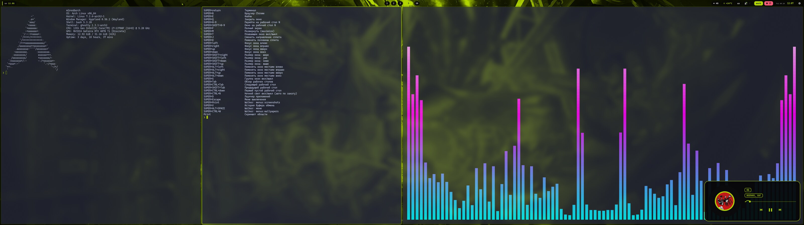
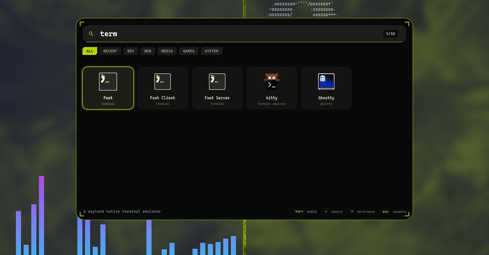
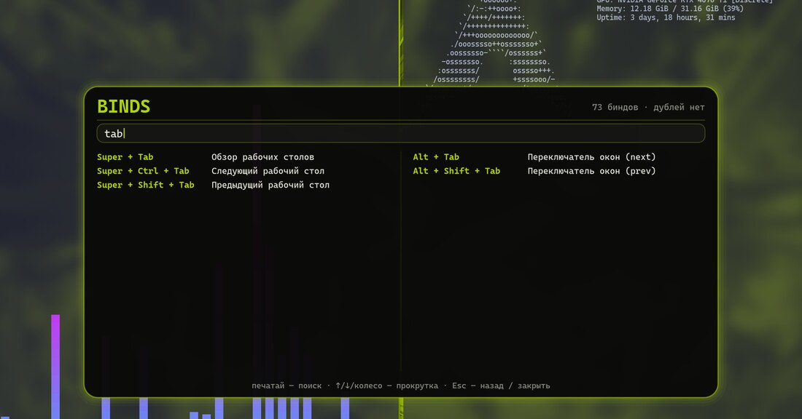
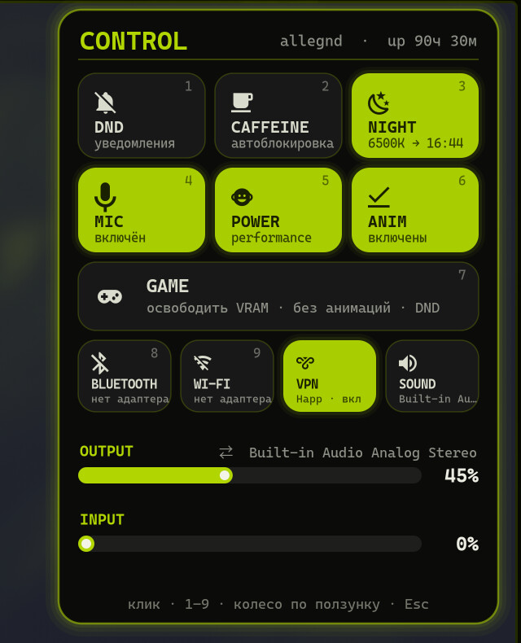
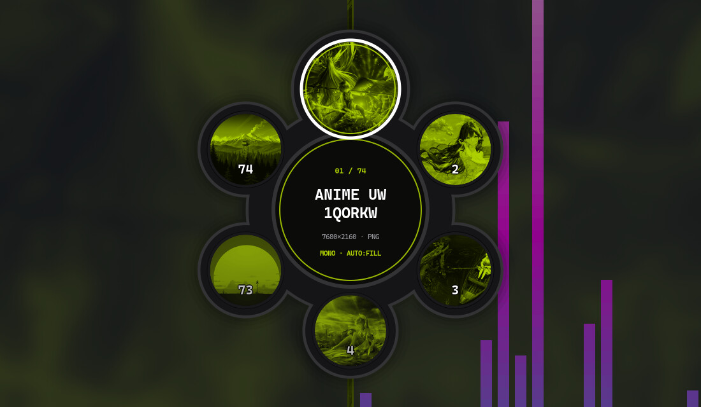
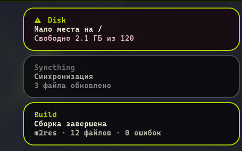
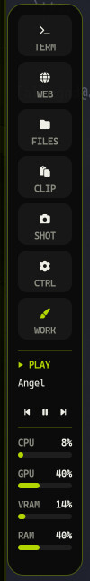
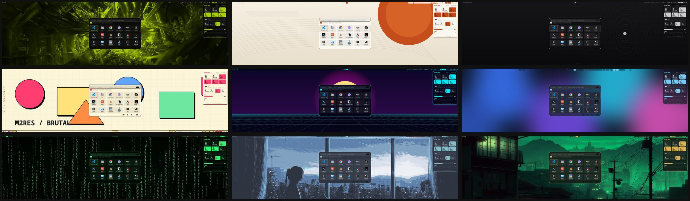

<h1 align="center">m2res</h1>

<p align="center">
  <b>A complete Hyprland desktop rice</b> — bar, dock, lock screen, notifications, player, launcher, profiles, screen recording, screenshots, OCR and dictation, with one-command theme switching.
</p>

<p align="center">
  <a href="README.md"><b>English</b></a> · <a href="README.ru.md">Русский</a>
</p>

<p align="center">
  
  
  
  
</p>

<p align="center">
  
</p>

<p align="center"><i>Waybar, a visualizing music player and terminals — captured on a real 5120×1440@120 monitor.</i></p>

---

## Contents

- [Features](#features)
- [Gallery](#gallery)
- [Rices: one-command theme switching](#rices-one-command-theme-switching)
- [Keyboard shortcuts](#keyboard-shortcuts)
- [Installation](#installation)
- [Uninstall](#uninstall)
- [Documentation](#documentation)

## Features

| | |
|---|---|
| 🎛️ **Bar and dock** | Waybar with a rice-driven layout, plus an auto-hiding side or bottom dock |
| 🔒 **Lock screen** | Retro-TV HUD with the rice palette and a readable failure reason |
| 🔔 **Notifications** | Mako styled to the rice, with a notification center (`SUPER+N`) |
| 🎵 **Player** | Music player with a live audio visualizer (`SUPER+P`) |
| 🚀 **Launcher** | App launcher (`SUPER+D`), control center (`SUPER+X`), keybind cheatsheet (`SUPER+F1`) |
| 🖼️ **Wallpapers** | Carousel picker with transitions (`SUPER+W`); the accent follows the wallpaper |
| 🎨 **Rices** | Switch the whole look at once, with a live preview that reverts itself |
| 🗂️ **Profiles & layouts** | Cycle work profiles (`SUPER+CTRL+P`) and per-workspace window presets |
| 🎙️ **Recording & capture** | Screen recording, screenshots with an editor, clipboard history |
| 🔤 **OCR & dictation** | Text from screen regions and offline speech-to-text via Whisper |
| 🩺 **Self-check** | `m2res-doctor` verifies the whole setup (66 checks) |

## Gallery

<table>
  <tr>
    <td align="center" width="50%"><br><sub><b>Launcher</b> · <code>SUPER+D</code></sub></td>
    <td align="center" width="50%"><br><sub><b>Keybind cheatsheet</b> · <code>SUPER+F1</code></sub></td>
  </tr>
  <tr>
    <td align="center"><br><sub><b>Control center</b> · <code>SUPER+X</code></sub></td>
    <td align="center"><br><sub><b>Wallpaper picker</b> · <code>SUPER+W</code></sub></td>
  </tr>
  <tr>
    <td align="center"><br><sub><b>Notifications</b></sub></td>
    <td align="center"><br><sub><b>Dock</b> · <code>SUPER+SHIFT+B</code></sub></td>
  </tr>
</table>

## Rices: one-command theme switching

A **rice** is a complete look. Applying one changes the palette, wallpaper, Waybar, Hyprland geometry and animations, widget shapes, notifications, the lock screen, Ghostty, the dock and sounds.

- **8 author rices:** `m2res`, `paper`, `zen`, `brutal`, `cyber`, `glass`, `tty`, `macos`
- **6 palette themes:** Catppuccin, Everforest, Matte Black, Nord, Osaka Jade, Ristretto



Press **`SUPER+ALT+R`** to open the carousel. **Enter** tries a rice for 10 seconds, then asks whether to keep it: Enter keeps it, Esc reverts, and no answer reverts it automatically.

From a terminal:

```bash
m2res-rice list                # available rices
m2res-rice apply <name>        # switch to a rice
m2res-rice preview <name>      # try it temporarily
m2res-rice back                # return to the previous rice
m2res-rice import-themes       # import the palette themes
```

Full reference (Russian): [.config/m2res/README.md](.config/m2res/README.md#райсы--переключатель-оформления-m2res-rice).

## Keyboard shortcuts

`SUPER+F1` shows the full, always up-to-date list. The most used:

| Shortcut | Action |
|---|---|
| `SUPER+D` | Launcher |
| `SUPER+X` | Control center |
| `SUPER+N` | Notification center |
| `SUPER+P` | Music player |
| `SUPER+W` | Wallpaper picker |
| `SUPER+ALT+R` | Rice carousel |
| `SUPER+CTRL+P` | Cycle work profile |
| `SUPER+SHIFT+B` | Toggle dock |
| `SUPER+L` | Lock screen |
| `SUPER+F1` | Keybind cheatsheet |

## Requirements

- Arch Linux with `pacman` and, optionally, an AUR helper
- Hyprland **0.56+** with the Lua config (`~/.config/hypr/hyprland.lua`)
- A wide monitor; the layouts were designed for **32:9** (5120×1440) and adapt to other sizes

## Installation

```bash
git clone https://github.com/orybakov/m2res-rice.git
cd m2res-rice
bash install.sh
```

The installer:

1. installs missing packages with `pacman` and the AUR (it builds `yay` first if needed and asks for your `sudo` password once);
2. backs up your existing `~/.config/m2res` to `~/Backups/m2res/pre-install-*.tar.gz`;
3. copies the rice, enables autostart and keybinds, and runs `m2res-doctor`;
4. creates `~/.config/hypr/hyprland.lua` with basic keybinds if you don't have one.

Options:

| Flag | Effect |
|---|---|
| `--check` | Only check dependencies and the Hyprland config; change nothing |
| `--no-user` | Skip the Whisper model (~0.5 GB) and the OCR dictionary |
| `--no-enable` | Don't touch `hyprland.lua` |
| `--yes` | Don't ask questions |
| `--info` | Print the installer summary |

After installing, press `SUPER+F1` for the keybind list.

## Uninstall

```bash
~/.config/m2res/scripts/m2res-enable off
```

This removes autostart and keybinds from `hyprland.lua`. Your backup stays in `~/Backups/m2res/`.

## Documentation

- [Full guide (Russian)](.config/m2res/README.md) — rices, scripts, configuration
- [Русская версия этого README](README.ru.md)

<p align="center"><sub>Issues and pull requests are welcome.</sub></p>
